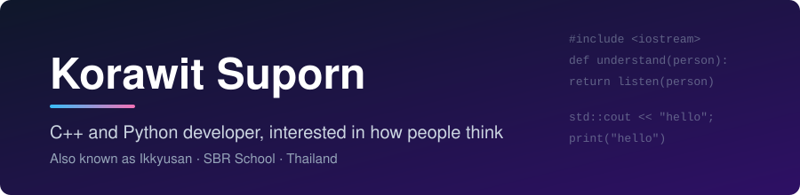
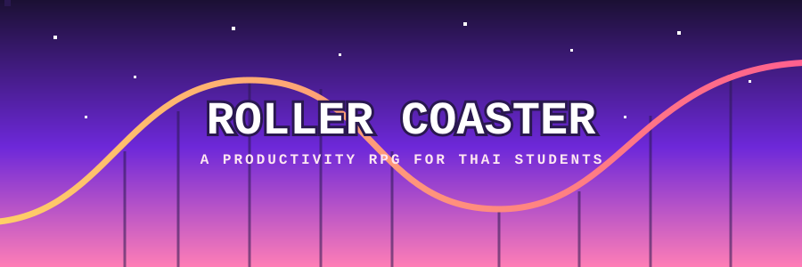

 

 

## About

I'm a student at SBR School who writes code on the side of everything else. Most people call me Ikkyusan.

I got into computers because I like making a machine do exactly what I tell it to. I got interested in psychology because people almost never do. Nearly everything I build sits between those two facts.

My daily drivers are **C++** and **Python**. I reach for C++ when I want to feel how the machine works, and Python when I want an idea running before dinner.

 

## Main project: Roller Coaster

 

**[Open the live app](https://rollercoaster-nine.vercel.app)** · [Brand guidelines](https://design-rollercoaster.web.app/) · now called *I Love TCAS*

Thai students have to choose a career, a major and a university at an age when most of us can't say what we want for lunch. The advice usually comes as a pamphlet or a rankings list. Neither helps with the part that matters, which is doing something about it every day.

Roller Coaster treats that as a game.

| Start | Plan | Play | Connect |
|---|---|---|---|
| Pick your MBTI. A pixel-art character for your type becomes your avatar. | Choose a career, a skill track, a university and a major. | Daily tasks earn coins and keep a streak alive. Spend coins on skills such as Ignite, a 5-second countdown, or Capsule, a lock timer with a bonus. | Real-time chat, a school map and a match score put you next to students on the same road. |

Most of the psychology lives in the small mechanics. Streaks and rewards pull you back. A Gemini-powered coach writes a small daily task from the goal you pinned, then reflects on how it went. I spent a lot of time on those prompts.

The code is in a private repo, so the live app is the thing to look at. There's also a demo extension on top of it, which goes from a chat with a shop assistant to a PromptPay QR code and a slip upload.

 

## Skills

<table>
<tr>
<td width="50%" valign="top">

**C++**

Problem-solving and graders, plus mobile work in Coaster Center. I like it because nothing is hidden from you.

</td>
<td width="50%" valign="top">

**Python**

Libraries such as ApexDroneKit, computer-vision work and automation scripts. What I use when I want something running by tonight.

</td>
</tr>
<tr>
<td width="50%" valign="top">

**JavaScript and TypeScript**

React front ends, with Firebase and Vercel serverless behind them. Everything in Roller Coaster and singjourney.

</td>
<td width="50%" valign="top">

**Psychology and product**

MBTI, habit loops, motivation, and what makes someone stay in a conversation. I try to build it into the interface instead of bolting it on.

</td>
</tr>
</table>

 

## More projects

 

## GitHub activity

<picture>
  <source media="(prefers-color-scheme: dark)" srcset="https://raw.githubusercontent.com/Su-Korawit/Su-Korawit/output/github-contribution-grid-snake-dark.svg"/>
  
</picture>

 

## Contact

I write up what I learn, including the parts I got wrong first, at **[ikkyusanstudy.me](https://ikkyusanstudy.me)**. That's the best way to reach me. Opening an issue on any repo works too.

I'm open to internships, projects and people who want to build something odd.
